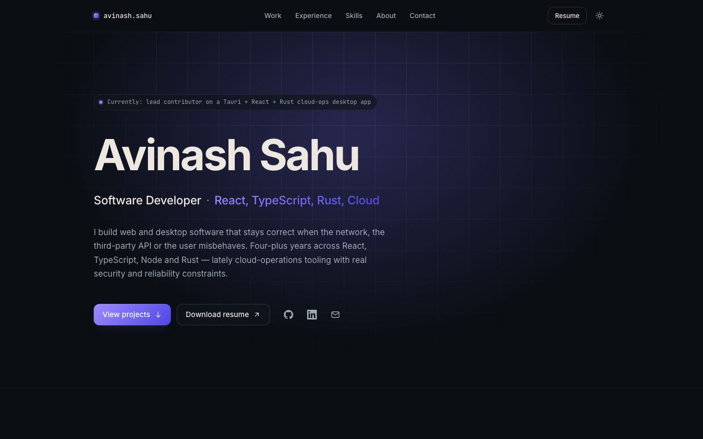

# avinash9694.github.io

Personal portfolio of Avinash Sahu — software developer in Hyderabad working in React, TypeScript, Rust and the cloud.

**Live:** [avinash9694.github.io](https://avinash9694.github.io/)



## Why I built this

I wanted a single page that a hiring manager can read in two minutes: what I have shipped, where, and what it was built with. The old site was a template with skill bars and stock icons; this one is hand-built, dark-first, and puts the project grid first, because the projects are the evidence.

## Features

- Single page, six sections: hero, selected work, experience timeline, grouped skills, about, contact.
- Sticky navigation with smooth scroll and active-section highlighting (IntersectionObserver), collapsing to a menu on small screens.
- Dark-first theme that follows `prefers-color-scheme`, with a toggle persisted in `localStorage` and a `?theme=dark|light` override for sharing.
- Project cards with real screenshots served as 1200px WebP (351 KB for all eight) in a fixed 16:10 box, lazy-loaded and faded in over a generated SVG cover (gradient plus a deterministic motif derived from the slug) that stays visible while the image loads or when a project has no live site.
- A grid that never leaves an orphan: when the last card would sit alone in its row, it spans the row as a horizontal card instead, at both the 2- and 3-column breakpoints.
- Open Graph and Twitter card image (`public/og.png`, rendered from `public/og.html`) so shared links show the hero.
- Scroll-triggered reveal animations that are disabled entirely under `prefers-reduced-motion`.
- Semantic landmarks, skip link, labelled icon links, visible focus rings and 40px+ touch targets.
- Responsive from 360px up with no horizontal overflow.
- `404.html` that redirects back to the root so stale deep links still land on the site.

## Architecture

```
index.html            theme bootstrap script (runs before paint to avoid a flash)
src/
  app.tsx             section order
  data/               all content: projects, experience, skills, site links
  components/         one component + one CSS module per section
  hooks/              use-theme, use-active-section, use-reveal
  styles/global.css   design tokens (every colour is a custom property), reset, reveal
```

Content lives entirely under `src/data/`. Adding a project is one object in `src/data/projects.ts`; the tests there check every entry has a valid `https` source URL, a valid live URL when one exists, a unique slug, tags, a two-stop cover gradient, and that every live project points at a `screenshot` that exists under `public/screenshots/`.

Screenshots are produced by `npm run screenshots` (`scripts/optimize-screenshots.mjs`), which reads the 1440×900 captures from a sibling `_shots/` directory and writes 1200×750 WebP files with sharp.

## Tech stack

React 18 · TypeScript (strict) · Vite 6 · CSS Modules · Vitest + Testing Library · ESLint (typescript-eslint, react-hooks, jsx-a11y) · Prettier · GitHub Actions → GitHub Pages

## Running locally

```bash
npm ci
npm run dev        # http://localhost:5173
npm run build      # type-check + production build to dist/
npm run preview    # serve dist/
```

## Testing

```bash
npm test           # vitest run
npm run lint       # eslint, zero warnings
npm run typecheck  # tsc -b --noEmit
npm run format:check
```

Two suites: `src/data/projects.test.ts` (data invariants) and `src/app.test.tsx` (render smoke test covering landmarks, every project card, the experience timeline, the footer credit and the theme toggle).

## Project structure

```
.github/workflows/deploy.yml   lint → typecheck → test → build → Pages
public/                        resume PDF, monogram, favicon, og.png + og.html, 404 redirect
public/screenshots/            one WebP per live project
scripts/optimize-screenshots.mjs  PNG → WebP pipeline
src/components/                about, experience, footer, hero, nav, project-card,
                               project-cover, projects, section-heading, skills, theme-toggle
src/data/                      projects.ts, experience.ts, skills.ts, site.ts
src/hooks/                     use-theme.ts, use-active-section.ts, use-reveal.ts
src/styles/global.css          tokens and base styles
```

## Roadmap and known limitations

- Real-time Task Board has no hosted demo (it needs a long-lived socket server), so it keeps its generated cover and is listed as source only.
- The contact section is a `mailto:` link rather than a form; there is no backend to post to.
- Screenshots are desktop captures only; a mobile variant per project would need a second image set.

## License

MIT — see [LICENSE](LICENSE).
